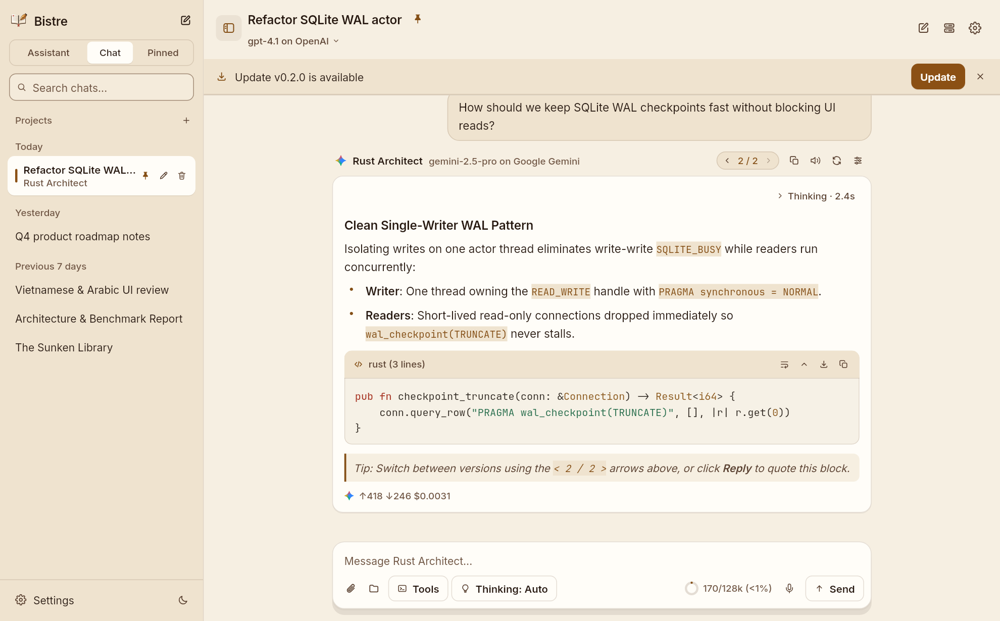
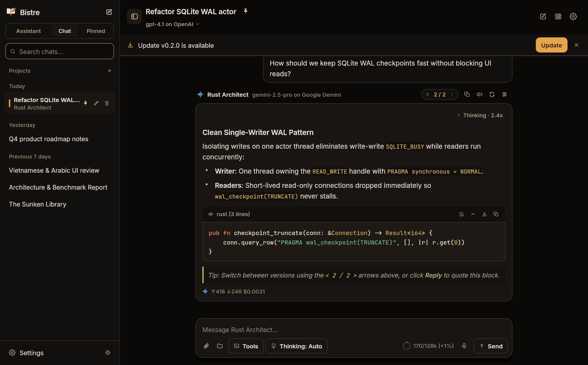
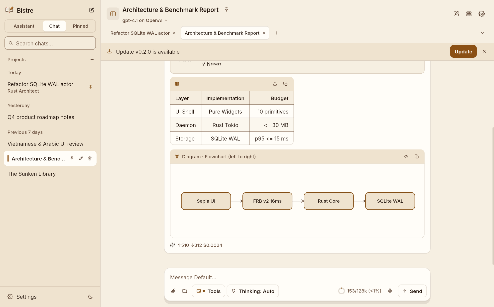
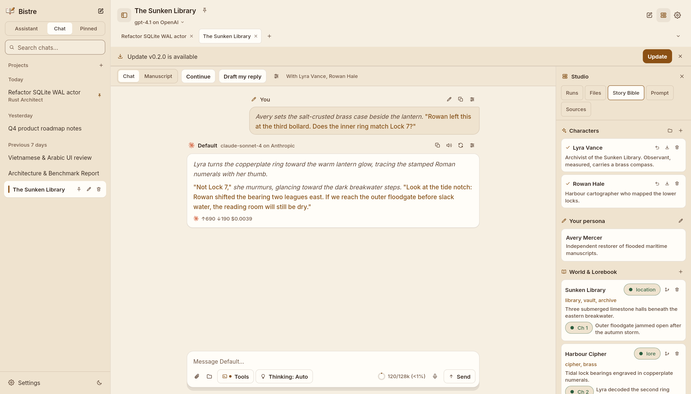
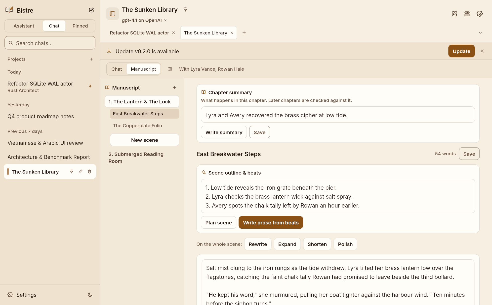
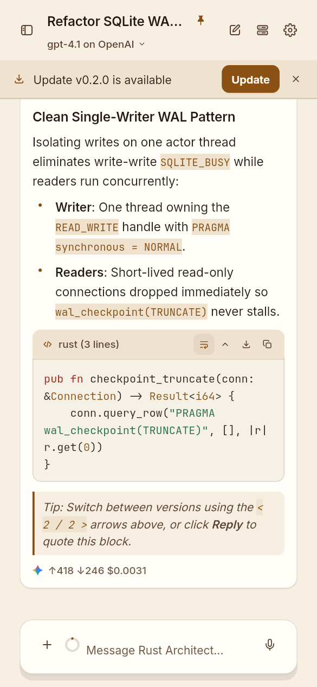
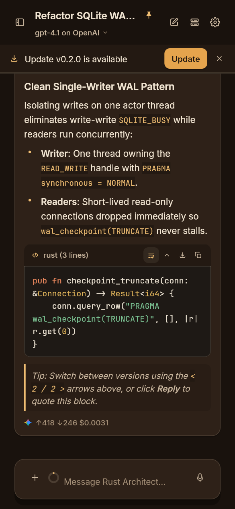
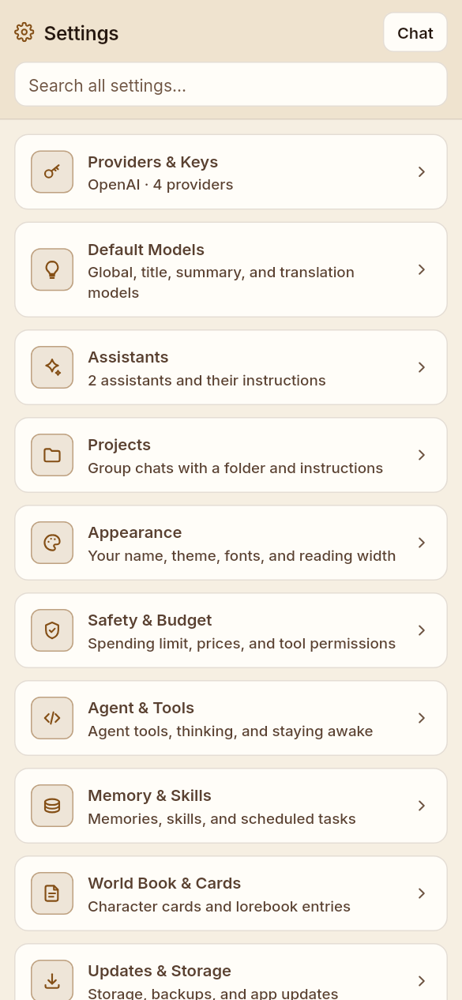

<p align="center">
  
</p>

<h1 align="center">Bistre</h1>

<p align="center">
  Local-first, zero-telemetry AI client for Windows, Linux, and Android.<br/>
  One pure-Rust engine paired with a thin Flutter UI.
</p>

<p align="center">
  <a href="https://github.com/baros4294/bistre/releases/download/v1.1.0/bistre-v1.1.0-windows-x64-setup.exe"></a>
  <a href="https://github.com/baros4294/bistre/releases/download/v1.1.0/bistre-v1.1.0-android-arm64.apk"></a>
  <a href="https://github.com/baros4294/bistre/releases/download/v1.1.0/bistre-v1.1.0-linux-x64.AppImage"></a>
</p>

<p align="center">
  <a href="https://github.com/baros4294/bistre/actions/workflows/ci.yml"></a>
  <a href="LICENSE"></a>
  <a href="SECURITY.md"></a>
  <a href="changelog.md"></a>
</p>

<p align="center">
  
</p>

## Download

Direct installers for Windows, Linux, and Android. Once installed, Bistre verifies signed updates in Settings > Updates & Storage. See what changed in [`changelog.md`](changelog.md).

| Platform | Direct download | Additional formats | Notes |
|---|---|---|---|
| Windows (`x64`) | [Installer (`-setup.exe`)](https://github.com/baros4294/bistre/releases/download/v1.1.0/bistre-v1.1.0-windows-x64-setup.exe) | [Portable `.zip`](https://github.com/baros4294/bistre/releases/download/v1.1.0/bistre-v1.1.0-windows-x64.zip), [SHA-256](https://github.com/baros4294/bistre/releases/download/v1.1.0/sha256sums-windows-x64.txt) | Per-user install, native Win11 DWM frame, global quick-entry shortcut. Builds are unsigned, so SmartScreen may prompt on first run |
| Android (`arm64-v8a`) | [APK (`.apk`)](https://github.com/baros4294/bistre/releases/download/v1.1.0/bistre-v1.1.0-android-arm64.apk) | [SHA-256](https://github.com/baros4294/bistre/releases/download/v1.1.0/sha256sums-android-arm64.txt) | Edge-to-edge layout, 16 KB page alignment, Keystore-backed vault, foreground service for live runs |
| Linux (`x64`) | [AppImage (`.AppImage`)](https://github.com/baros4294/bistre/releases/download/v1.1.0/bistre-v1.1.0-linux-x64.AppImage) | [`.deb`](https://github.com/baros4294/bistre/releases/download/v1.1.0/bistre-v1.1.0-linux-x64.deb), [`.rpm`](https://github.com/baros4294/bistre/releases/download/v1.1.0/bistre-v1.1.0-linux-x64.rpm), [`.tar.gz`](https://github.com/baros4294/bistre/releases/download/v1.1.0/bistre-v1.1.0-linux-x64.tar.gz), [SHA-256](https://github.com/baros4294/bistre/releases/download/v1.1.0/sha256sums-linux-x64.txt) | Native Wayland/X11 build with an active-scoped background daemon |

## Screenshots

| Dark theme (Pure Black) | Tables, LaTeX math, and Mermaid |
|---|---|
|  |  |

| Story Bible and Write mode | Manuscript canvas |
|---|---|
|  |  |

<p align="center">
  
  
  
</p>

## Capabilities

Bistre gives desktop and mobile users one fast, private AI workspace with zero cloud lock-in, analytics, or browser wrappers.

### Privacy, budget, and local storage
- Local SQLite WAL storage: Conversations, FTS5 search indexes, attachments, and settings stay on your device. Requests default to stateless mode (`store: false`) with zero telemetry.
- Wallet Shield: Exact integer spending limits (`MoneyMicros`) reserve budget before every paid request and stop runs cleanly when a daily or per-chat cap is reached.
- OS-backed key vault: API keys are encrypted with platform keystores and never stored in plain text. Provider settings can be shared as a compact code without exposing your key.

### Providers, agents, and files
- Multi-provider engine: Connect OpenAI, Google Gemini, Anthropic, OpenRouter, local servers, or any Custom OpenAI-compatible endpoint with automatic multi-key rotation and self-healing retries.
- Projects and autonomous runs: Group chats into projects with dedicated folders, instructions, and reviewable hooks. Run multiple chats concurrently with per-tool approval rules (`Ask`, `Allow`, `Off`), scheduled background runs, and MCP server tools.
- Workspace and media tools: Attach, paste, or drop files and pictures, review workspace diffs with 1-tap rewind, generate images and speech, and use opt-in desktop computer use or Android phone use that confirms before every action.

### Reading, coding, and long-form writing
- Calm pure-Widgets UI: Built on `package:flutter/widgets.dart` with zero Material/Cupertino kits or webviews. Ships with 9 curated light and dark presets, Bubbles and Document layouts, GFM tables, offline LaTeX math, Mermaid diagrams, inline SVG preview, 200% text scaling, and full RTL support (`en`, `vi`, `ar`).
- Branching and Story Studio: Navigate branching conversation trees, pin replies, inspect exact context breakdown and prompt cache boundaries, manage Story Bible and Lorebook V3 entries, and draft long-form chapters in the Manuscript canvas.

## Architecture

One pure-Rust core handles protocols, storage, budgeting, tools, and cryptography. The Flutter shell renders state and forwards intents over a 16 ms delta-coalesced FFI bridge.

```text
apps/bistre_app        Thin pure-Widgets Flutter UI (zero HTTP, SQL, or domain logic)
crates/bistre-ffi      flutter_rust_bridge v2 DTO bridge & 16 ms delta coalescing
crates/bistre-core     Providers, SSE, tokenizer, compaction, tools, MCP, Story Studio, Wallet Shield
crates/bistre-storage  Single-writer SQLite WAL actor, Expand-Contract migrations, FTS5 search
crates/bistre-crypto   Offline Ed25519 signature verification & OS secret vault traits
crates/bistre-protocol Shared domain types, MoneyMicros, and typed DiagnosticKey codes
crates/bistre-daemon   Active-scoped desktop daemon (IPC, housekeeping, OS sleep guard)
```

- Architecture and live implementation status: [`docs/specs/00-architecture.md`](docs/specs/00-architecture.md)
- Technical specifications: [`docs/specs/`](docs/specs/) · Architecture Decision Records: [`docs/adr/`](docs/adr/)
- Design system and visual tokens: [`docs/design/design.md`](docs/design/design.md)

## Quick Start (Development)

### Prerequisites

- Rust 1.100.0 (pinned in `rust-toolchain.toml`) + `cargo-nextest` + `cargo-deny`
- Flutter 3.50.1 (pinned in `.github/workflows/ci.yml`)
- Android NDK 30.0.16248370 (for Android builds; pinned in `apps/bistre_app/android/app/build.gradle.kts`)
- `just` command runner (`cargo install just` or OS package manager)

### Run and verify

```bash
# Run the desktop app in debug mode (uses isolated .bistre-dev/ storage)
cd apps/bistre_app && flutter run -d windows   # or -d linux

# Run all formatting, architecture guard, lint, i18n, Rust, and Flutter gates
just check-all

# Render UI gallery screenshots (desktop, phone, 200% text, RTL)
just ui-gallery

# Print or raise the app version (see CONTRIBUTING.md, Versions and Releases)
just version
just bump minor

# Check local build cache budgets; keep only the debug and Android caches
just disk
just prune
```

See [`CONTRIBUTING.md`](CONTRIBUTING.md) for the full developer workflow, translation guide, and CI overview.

## Localization

Bistre ships with hot-loadable ICU message catalogs under [`l10n/catalog/`](l10n/catalog/) (`en`, `vi`, and RTL `ar`) with zero hardcoded UI strings. To add a language:

1. Copy [`l10n/catalog/en.bistre-l10n.json`](l10n/catalog/en.bistre-l10n.json) to `l10n/catalog/<bcp47>.bistre-l10n.json`.
2. Set `"locale"` and `"direction"` (`ltr` or `rtl`) and translate each `entries.<key>.message` following its `context`, `tone`, and `max_chars`.
3. Run `just i18n-gen` and `just i18n-check`.

## Security, Community, and License

- Security: See [`SECURITY.md`](SECURITY.md) for vulnerability reporting and our cryptographic release verification model.
- Contributing: See [`CONTRIBUTING.md`](CONTRIBUTING.md) and [`AGENTS.md`](AGENTS.md) for engineering invariants.
- Code of Conduct: Participation is governed by [`CODE_OF_CONDUCT.md`](CODE_OF_CONDUCT.md).
- License: Released under the [MIT License](LICENSE). Third-party attributions live in [`third-party-notices.md`](third-party-notices.md).
